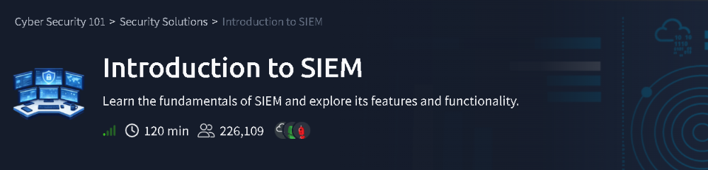
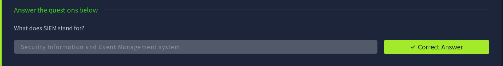
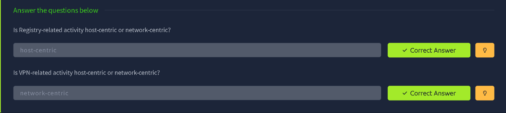
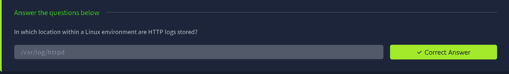
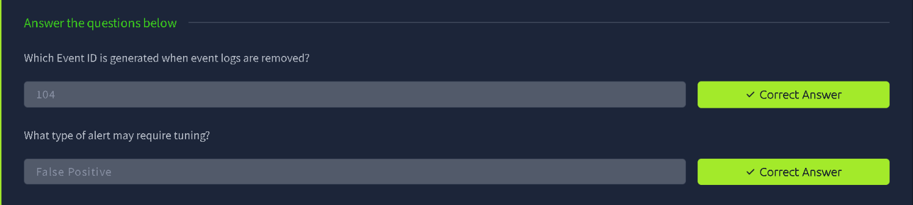
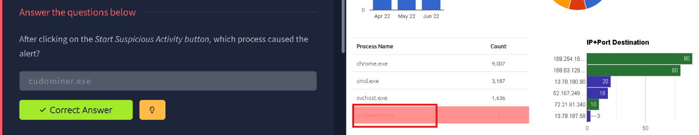
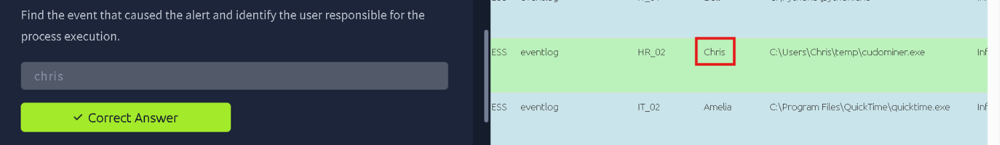
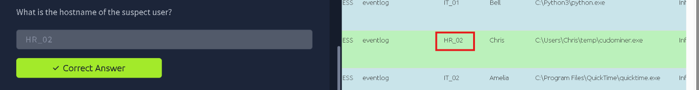
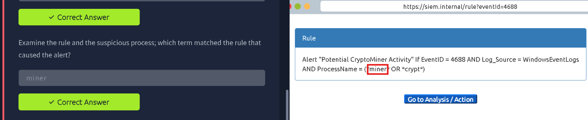
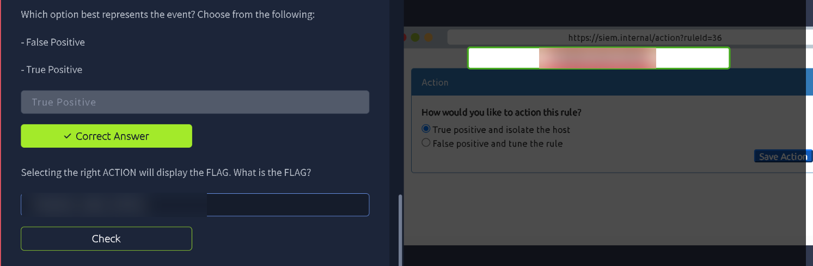

# TryHackMe: Introduction to SIEM

> **Track:** Cyber Security 101 → Security Solutions
> **Difficulty:** Easy · **Time:** ~120 min
> **Focus:** What a SIEM is, which log sources feed it, how alerts and rules work, and a hands-on triage of a crypto-miner alert



---

## Summary

A **SIEM** (Security Information and Event Management) system collects logs from many sources, normalises them, correlates events and raises alerts when something matches a detection rule. This room covers the theory, then drops you into a simulated SIEM to investigate a real-looking alert.

| Part | What I did |
|---|---|
| Concepts | SIEM definition, host-centric vs network-centric logs, where Linux and Windows logs live |
| Concepts | Alert tuning and false positives |
| Hands-on | Trigger suspicious activity and find the process that raised the alert |
| Hands-on | Identify the user and host, read the detection rule, then decide on the right response |

The practical is done in a browser-based SIEM simulation, so there are no shell commands. This writeup follows the **analysis workflow**.

---

## Step 1: What is a SIEM?

SIEM stands for **Security Information and Event Management** system. It centralises log data from across an environment so analysts can search, correlate and alert on it from a single place.



**Takeaway:** Instead of logging into each machine separately, the SIEM gives one view across endpoints, servers and network devices.

---

## Step 2: Log Sources, Host-Centric vs Network-Centric

SIEM log sources fall into two groups:

- **Host-centric:** activity on an individual machine (for example Windows Registry changes, process creation, file activity).
- **Network-centric:** activity on the wire or at network devices (for example VPN connections, firewall traffic, proxy logs).



**Takeaway:** Registry-related activity is host-centric, while VPN-related activity is network-centric. Knowing the category tells you which source to check first.

---

## Step 3: Where Logs Live

Each platform stores logs in different places, and a SIEM ingests from them:

- **Linux HTTP (Apache) logs** are stored in `/var/log/httpd`.



**Takeaway:** If you need to inspect a web server by hand on a Red Hat-style Linux system, start in `/var/log/httpd`. (On Debian/Ubuntu, Apache usually logs to `/var/log/apache2`.)

---

## Step 4: Windows Event IDs and Alert Tuning

Two more concepts the room tests:

- **Event ID 104** is generated when event logs are cleared. Attackers wipe logs to hide their tracks, so this is a high-value event to alert on.
- **False positives** are alerts that fire on harmless activity. Rules that produce too many of them need **tuning**, so analysts aren't buried in noise.



**Takeaway:** A good SIEM is both sensitive and quiet. Detection rules get refined over time as false positives show up.

---

## Step 5: Hands-On Investigation

The practical simulates a SIEM dashboard. After clicking **Start Suspicious Activity**, an alert appears and the goal is to work out who did what, and where.

### 5.1 Find the process that caused the alert

On the dashboard's **Process Name** table, most entries are normal and high-volume (`chrome.exe`, `cmd.exe`, `svchost.exe`). One stands out: **`cudominer.exe`**, with a count of just **1**, highlighted as the outlier.



> **Why this matters:** In a table sorted by frequency, a rare process with a name like "miner" is suspicious. Cryptominers are a common payload because they quietly steal CPU time.

### 5.2 Identify the responsible user

Opening the event behind the alert shows a row where the process was run from `C:\Users\Chris\temp\cudominer.exe`. The user column identifies who executed it: **Chris**.



> **Note:** The path matters. An executable launched from a user's `temp` folder, rather than `C:\Program Files`, is another warning sign. Compare it with the legitimate `quicktime.exe` entry below it, which runs from Program Files.

### 5.3 Identify the host

The same row gives the machine the activity came from: **HR_02**.



### 5.4 Read the detection rule

Next I opened the rule that fired. It is a Windows process-creation rule (**Event ID 4688**):

```
Alert "Potential CryptoMiner Activity"
If EventID = 4688 AND Log_Source = WindowsEventLogs
AND ProcessName = (*miner* OR *crypt*)
```

The process name `cudominer.exe` matches the wildcard **`*miner*`**, which is why the alert triggered.



**Takeaway:** Understanding *why* a rule fired lets you judge whether the alert is real or just a naming coincidence.

### 5.5 Decide on the response and get the flag

The final step is to classify the alert and take the matching action:

- The process is a genuine cryptominer running from a user's temp folder, so the event is a **True Positive**.
- The right action is **"True positive and isolate the host"**, rather than "False positive and tune the rule".

Choosing the correct action reveals the flag.



> 🔒 The flag is intentionally blurred. Triage the alert yourself to reveal it.

---

## Key Takeaways

1. A **SIEM** centralises, correlates and alerts on logs from many sources.
2. Know the difference between **host-centric** and **network-centric** data.
3. **Event ID 104** (log cleared) and **4688** (process creation) are worth remembering.
4. **Outliers in process tables** and executables in **temp folders** are good starting points.
5. Read the **rule logic** before deciding if an alert is a **true or false positive**.
6. A confirmed true positive on an endpoint calls for **isolating the host**.

## Skills Practised

`SIEM` · `Alert Triage` · `Log Source Analysis` · `Windows Event IDs` · `Detection Rules` · `True/False Positive Analysis` · `Incident Containment`

---

*Room: [Introduction to SIEM](https://tryhackme.com/room/introductiontosiem) on TryHackMe.*
